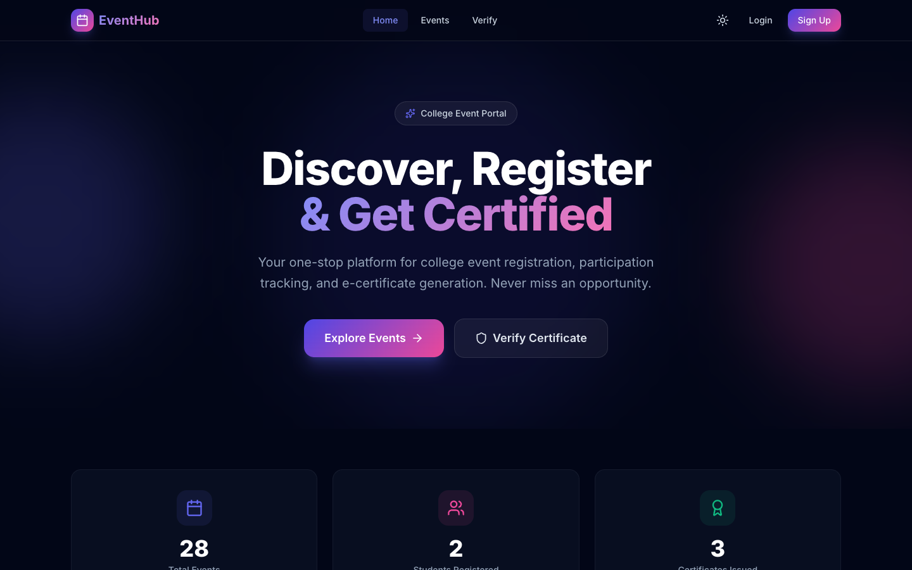
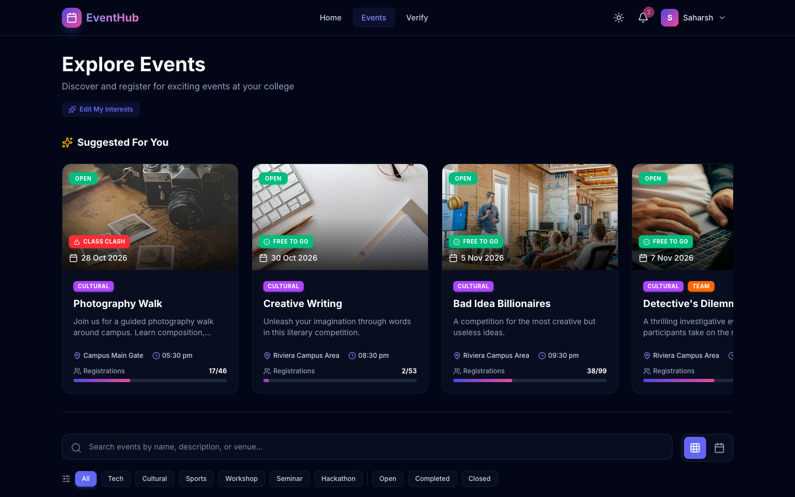
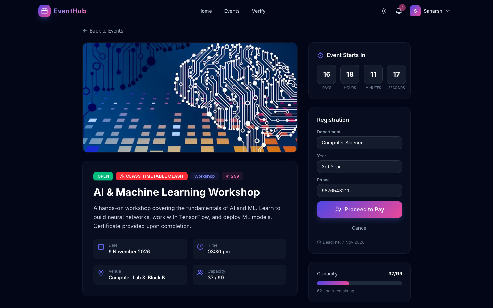
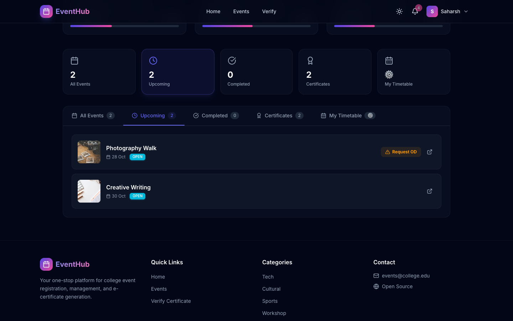
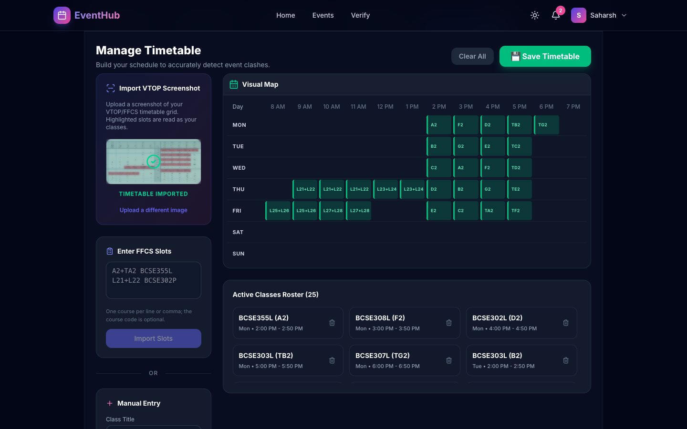
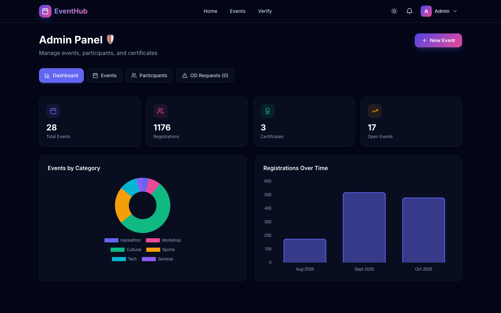
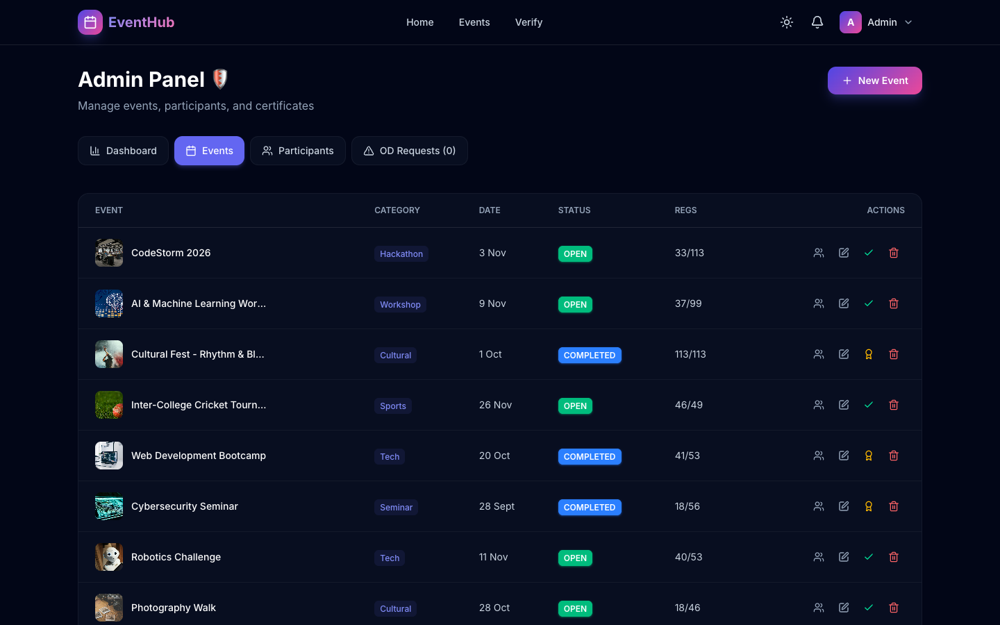
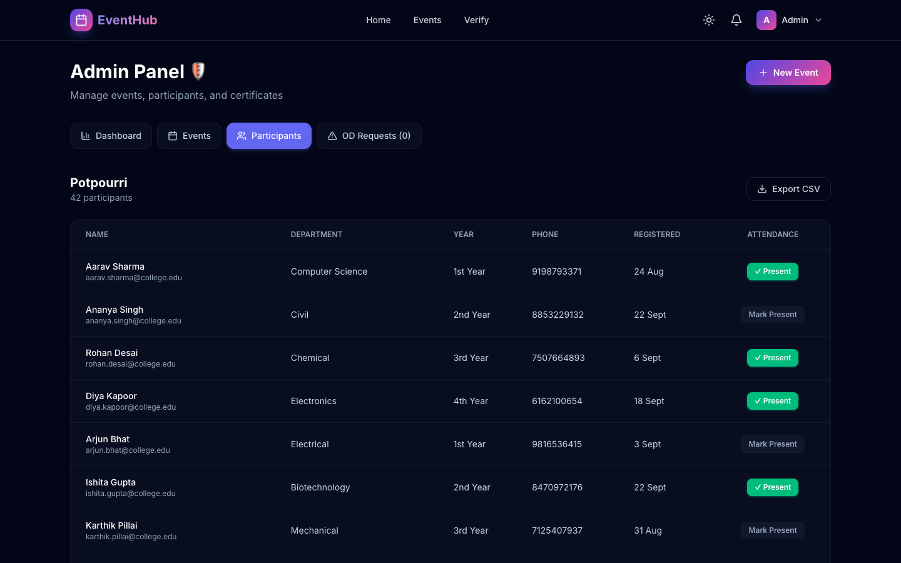
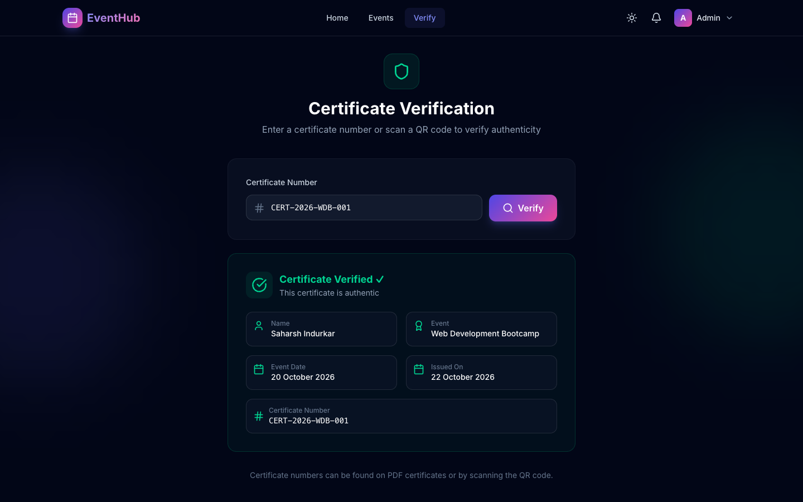
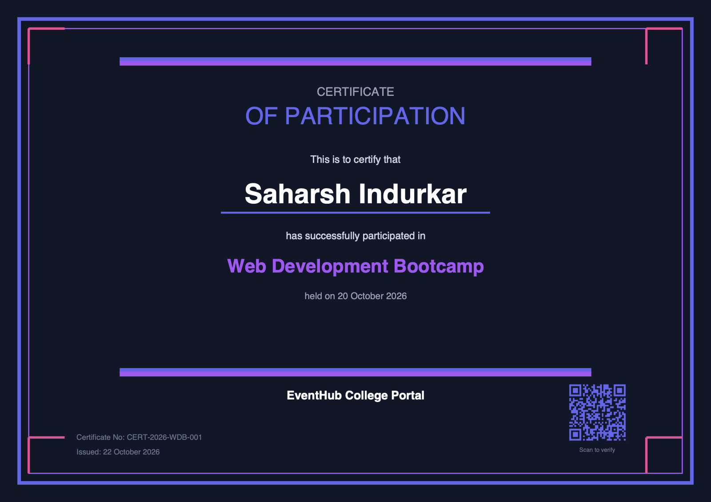

# College Event Registration and E-Certificate Portal

**EventHub** is a web portal where students discover and register for college events, organisers track attendance, and verifiable e-certificates are issued automatically.



## Student details

| Field | Detail |
| --- | --- |
| Name | Saharsh Indurkar |
| Registration number | 24BCE2527 |
| Programme / branch | B.Tech Computer Science and Engineering |
| Course code and slot | BCSE301L, A2+TA2 |
| Faculty guide | Saranya P |

## Features

| Module | What it does |
| --- | --- |
| Authentication | Sign up and log in as a student or organiser (admin); protected dashboard and admin routes |
| Event discovery | Search, category and status filters, grid and calendar views, interest-based suggestions |
| Registration | Form validation, team events with size limits, mock payment for paid events, deadline and capacity checks |
| Student dashboard | Upcoming and completed events, certificate PDF downloads, OD requests and OD letters |
| Smart timetable | Import a VTOP/FFCS timetable screenshot (OCR) or type slots; minute-accurate class-clash warnings |
| Admin panel | Create, edit and delete events; participants and attendance; CSV export; issue certificates; approve OD |
| Analytics | Totals, events by category and registrations per month |
| E-certificates | PDF with a unique certificate number and a QR code that opens the verification page |
| Verification | Public page that confirms a certificate's holder, event and dates |

## Tech stack

- React 19, Vite 8, React Router 7, Tailwind CSS 4
- jsPDF and QRCode for certificates and OD letters
- Chart.js for analytics, Tesseract.js for timetable OCR, Framer Motion for animation
- Browser localStorage behind a mock API layer (`src/services/api.js`), seeded with demo data

## Getting started

Requires Node.js 20 or later.

```bash
npm install
npm run dev
```

Then open http://localhost:5173.

| Role | Email | Password |
| --- | --- | --- |
| Organiser (admin) | admin@college.edu | admin123 |
| Student | student@college.edu | student123 |

Other scripts: `npm run build` (production build), `npm run preview` (serve the build), `npm run lint`.

## How it works

1. An organiser creates an event with its date, venue, seats and registration deadline.
2. Students register; the portal rejects registrations that are late, full, duplicated or for closed events.
3. The organiser marks attendance and then marks the event complete.
4. The portal issues one certificate per attendee, each with a unique number and a QR code.
5. Anyone can verify a certificate on the Verify page by its number or by scanning the QR code.

Students can also upload their VTOP timetable: highlighted slots are matched to the FFCS slot grid, every event is checked for a class clash, and a clashing event can be sent for OD approval.

## Project structure

```
src/
  components/   Navbar, event card, calendar, timetable grid, toasts
  context/      Auth, theme and notification state
  pages/        Home, events, event detail, dashboards, verify, login, signup
  services/     Mock API (api.js) and localStorage data layer (database.js)
  utils/        Certificates, OD letters, CSV export, clash check, FFCS slots, timetable OCR
case-study/screenshots/   Screenshots of every main screen
```

## Screenshots

| | |
| --- | --- |
|  |  |
|  |  |
|  |  |
|  |  |


